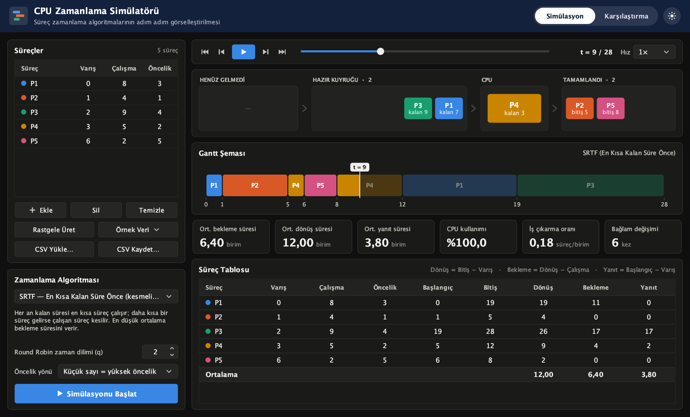

# CPU Zamanlama Simülatörü

İşletim Sistemleri dersi projesi: süreç zamanlama algoritmalarını simüle eden ve sonucu
adım adım görselleştiren bir Java uygulaması. Süreçleri ve çalışma sürelerini girdi olarak alır;
hangi sürecin ne zaman çalışacağını Gantt şeması, süreç tablosu ve özet ölçümlerle gösterir.



## Özellikler

- **Altı algoritma:** FCFS, SJF, SRTF (kesmeli SJF), Öncelikli Zamanlama (kesmesiz ve kesmeli), Round Robin
- **Animasyonlu simülasyon:** oynat / duraklat, birim birim ileri-geri, hız ayarı, zamanda gezinme
- **Canlı durum görünümü:** henüz gelmeyen süreçler → hazır kuyruğu → CPU → tamamlananlar
- **Gantt şeması:** oynatılan kısım canlı, kalan kısım soluk; üzerine tıklayarak o ana gidilir
- **Süreç tablosu:** başlangıç, bitiş, dönüş, bekleme ve yanıt süreleri ile ortalamalar
- **Özet ölçümler:** ortalama süreler, CPU kullanımı, iş çıkarma oranı, bağlam değişimi sayısı
- **Karşılaştırma görünümü:** aynı süreç seti tüm algoritmalarla çalıştırılır; tablo, çubuk grafik
  ve ortak zaman eksenli Gantt şemalarıyla yan yana gösterilir
- **Veri girişi:** düzenlenebilir tablo, hazır örnekler, rastgele üretim, CSV yükleme / kaydetme
- **Koyu ve açık tema:** varsayılan koyu temadır; sağ üstteki düğmeyle değiştirilir
- **Konsol modu:** aynı simülasyon grafik arayüz olmadan, ASCII Gantt şemasıyla

## Çalıştırma

Gereksinim: **Java 17 veya üzeri** (JDK). Başka hiçbir kütüphane gerekmez.

```bash
# Hazır JAR ile (her işletim sisteminde)
java -jar dist/CpuZamanlayici.jar
java -jar dist/CpuZamanlayici.jar --acik    # açık temayla başlatır

# Kaynaktan derleyip çalıştırmak için
./run.sh          # macOS / Linux
run.bat           # Windows
```

Bir IDE (IntelliJ IDEA, Eclipse, VS Code) ile açılacaksa kaynak klasörü `src`, ana sınıf
`scheduler.Main` ve dosya kodlaması **UTF-8** olmalıdır.

### Konsol modu

```bash
java -jar dist/CpuZamanlayici.jar --cli                       # süreçleri klavyeden sorar
java -jar dist/CpuZamanlayici.jar --cli --ornek               # hazır örnek, tüm algoritmalar
java -jar dist/CpuZamanlayici.jar --cli --dosya ornekler/temel.csv --algoritma rr --quantum 3
java -jar dist/CpuZamanlayici.jar --cli --yardim              # tüm seçenekler
```

Örnek çıktı:

```
=== Round Robin (q = 3) ===

Gantt Şeması:
+------+------+------+------+------+----+----+------+----+----+------+
|  P1  |  P2  |  P3  |  P4  |  P1  | P5 | P2 |  P3  | P4 | P1 |  P3  |
+------+------+------+------+------+----+----+------+----+----+------+
0      3      6      9      12     15   17   18     21   23   25     28

Süreç       Varış  Çalışma  Öncelik  Başlangıç  Bitiş  Dönüş  Bekleme  Yanıt
----------------------------------------------------------------------------
P1              0        8        3          0     25     25       17      0
P2              1        4        1          3     18     17       13      2
...
```

## Kullanım

1. Soldaki **Süreçler** tablosuna süreçleri girin (hücreye tıklayıp yazın) ya da
   **Örnek Veri**, **Rastgele Üret**, **CSV Yükle** düğmelerinden birini kullanın.
2. **Zamanlama Algoritması** kartından algoritmayı, Round Robin için zaman dilimini (q) ve
   öncelik yönünü seçin. Sonuçlar her değişiklikte anında güncellenir.
3. **Simülasyonu Başlat** düğmesi seçili algoritmayı baştan itibaren adım adım oynatır.
4. Sağ üstteki **Karşılaştırma** sekmesi tüm algoritmaların sonuçlarını yan yana gösterir.
5. Sağ üst köşedeki güneş / ay düğmesi koyu ve açık tema arasında geçiş yapar; girilen veriler korunur.


### CSV biçimi

```csv
ad,varis,calisma,oncelik
P1,0,8,3
P2,1,4,1
```

Ayırıcı olarak virgül, noktalı virgül ya da sekme kullanılabilir. Öncelik sütunu isteğe bağlıdır.
Boş satırlar ve `#` ile başlayan satırlar yok sayılır. Örnek dosyalar `ornekler/` klasöründedir.

## Algoritmalar

| Algoritma | Tür | Seçim ölçütü |
|---|---|---|
| FCFS — İlk Gelen İlk Çalışır | Kesmesiz | Hazır kuyruğuna giriş sırası |
| SJF — En Kısa İş Önce | Kesmesiz | En kısa çalışma süresi |
| SRTF — En Kısa Kalan Süre Önce | Kesmeli | En kısa kalan süre |
| Öncelikli Zamanlama | Kesmesiz | En yüksek öncelik |
| Öncelikli Zamanlama (kesmeli) | Kesmeli | En yüksek öncelik |
| Round Robin | Kesmeli (zaman dilimli) | FIFO kuyruk, her süreç en fazla q birim |

### Ölçümler

| Ölçüm | Hesaplama |
|---|---|
| Dönüş süresi (turnaround) | Bitiş − Varış |
| Bekleme süresi (waiting) | Dönüş − Çalışma süresi |
| Yanıt süresi (response) | CPU'yu ilk alma anı − Varış |
| CPU kullanımı | CPU'nun dolu olduğu süre / toplam süre |
| İş çıkarma oranı (throughput) | Süreç sayısı / toplam süre |
| Bağlam değişimi | CPU'nun bir süreçten farklı bir sürece geçme sayısı |

### Varsayımlar

- Zaman tam sayı birimlerle ilerler; simülasyon t = 0 anında başlar.
- Ölçüt eşitse önce gelen süreç, o da eşitse tabloda üstte olan süreç seçilir (FCFS).
- Kesmeli algoritmalarda çalışan süreç yalnızca ölçüte göre **kesin olarak** daha iyi bir süreç
  geldiğinde kesilir; eşitlikte çalışan süreç devam eder.
- Round Robin'de zaman dilimi dolduğu anda gelen süreç, kuyruğa kesilen süreçten **önce** girer.
  Kuyruk boşsa çalışan süreç yeni bir zaman dilimiyle devam eder.
- Öncelikte varsayılan olarak küçük sayı yüksek önceliktir; arayüzden tersi seçilebilir.
- Bağlam değişiminin süresi sıfır kabul edilir.

## Proje yapısı

```
src/scheduler/
├── Main.java                 Giriş noktası (grafik arayüz ya da --cli)
├── model/                    Veri sınıfları: süreç, Gantt dilimi, ölçümler, sonuç
├── algorithm/                Zamanlama motoru ve algoritmalar
│   ├── Scheduler.java        Ortak simülasyon motoru (Template Method)
│   ├── FcfsScheduler.java, SjfScheduler.java, SrtfScheduler.java,
│   │   PriorityScheduler.java, RoundRobinScheduler.java
│   └── AlgorithmType.java    Arayüzde listelenen algoritmalar
├── io/                       CSV okuma/yazma, hazır örnekler
├── cli/                      Konsol modu
└── ui/                       Swing arayüzü (Gantt şeması, canlı durum, karşılaştırma)
test/scheduler/SchedulerTest.java   Algoritma testleri
ornekler/                     Örnek CSV dosyaları
```

**Tasarım:** Tüm algoritmalar tek bir simülasyon motorunu (`Scheduler.simulate`) paylaşır. Motor
zamanı birer birim ilerletir; her birimde gelen süreçleri hazır kuyruğuna alır, gerekirse çalışan
süreci keser, CPU boşsa bir süreç seçer ve onu bir birim çalıştırır. Her algoritma yalnızca
kendini diğerlerinden ayıran üç şeyi tanımlar: **seçim ölçütü**, **kesmeli olup olmadığı** ve
**zaman dilimi**. Yeni bir algoritma eklemek için `Scheduler` sınıfını genişletmek yeterlidir.

## Testler

```bash
./test.sh
```

Algoritmalar, sonuçları elle hesaplanmış ders kitabı örnekleriyle (Silberschatz, *Operating System
Concepts*) ve 300 rastgele süreç seti üzerindeki tutarlılık kontrolleriyle sınanır.
